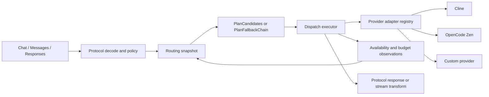

# Provider Unification and Enterprise Hardening Plan

- Date: 2026-11-07
- Status: Phases 1-4A completed; Phase 4B backend contract and deterministic shared-adapter proof completed; production multi-replica backend not configured
- Scope: the four confirmed provider-unification gaps
- Decision source: `docs/adr/0001-global-provider-capability-system.md`
- Delivery rule: preserve the current JSON compatibility stores and migrate behavior in reversible stages

## Outcome

RouteNest will have one provider-neutral, free-first request path for OpenAI Chat Completions, Anthropic Messages, OpenAI Responses, named combos, and configured fallback chains. A model offering will be identified by `(provider instance ID, model ID)`, so one provider's pricing, delisting, availability, or quota state cannot modify another provider's same-ID offering.

The completed work must provide:

1. Provider-scoped model offering state and provider-scoped import/delisting writes.
2. One production candidate planner and executor across every supported ingress protocol and provider family.
3. Candidate-based availability checks with no Cline-account prerequisite at an HTTP ingress.
4. Restart-safe quota and availability state, plus a defined atomic backend contract for multi-replica operation.

The system should be described as fully unified only after phases 1-3 pass. It should be described as restart-safe on one node only after phase 4A passes. It should be described as multi-replica enterprise-ready only after a production atomic shared backend is selected, configured, and passes the Phase 4B contract and concurrency suite. The deterministic shared adapter used to prove the contract is not a production multi-replica backend.

## Delivery status

- Phase 1 — completed on 2026-11-07. Provider offering state, mutations, routing eligibility, compatibility projection, persistence, and delisting notices are provider-scoped and verified.
- Phase 2 — completed on 2026-11-07. One immutable planner snapshot and provider-neutral executor now serve Chat, Messages, Responses, combos, and fallback chains behind reversible `legacy`, `shadow`, and `enforce` modes. Provider-scoped `onlyFree`, pins, same-ID collisions, credential/provider failover, semantic stream commit, egress snapshots, and request-log attribution are verified.
- Phase 3 — completed on 2026-11-07. Provider-only and Zen-only deployments no longer require a Cline account, and no-provider failures are provider-neutral availability responses.
- Phase 4A — completed on 2026-11-07. Budgets, token accounting, availability observations, expiry, recovery, resets, rollback, and legacy cooldown migration are restart-safe on one node through the existing sync-state compatibility owner.
- Phase 4B contract — completed on 2026-11-07. Atomic admission, idempotency, compare-and-set recovery, two-store shared limits/observations, and concurrency behavior are verified against a deterministic shared adapter.
- Production multi-replica backend — not configured. The local file adapter reports `multiReplicaSupported: false`; RouteNest must not be described as production multi-replica enterprise-ready until a real shared backend is selected and passes the same contract suite.

## Non-goals

- Replace the existing JSON compatibility files in one migration.
- Remove Cline, OpenCode Zen, connection, custom-provider, or admin compatibility APIs before parity is proven.
- Change public OpenAI, Anthropic, or Responses response shapes.
- Reorder named combo entries; combo order remains administrator-controlled.
- Infer that an unverified model is free.
- Add login, RBAC, SSO, or a repository-default password in these four phases. Authentication is recorded at the bottom as deferred work.

## Accepted constraints

The accepted ADR says the current stores remain authoritative compatibility sources during the behavioral migration (`docs/adr/0001-global-provider-capability-system.md:28-49`). The domain glossary lists those files and explicitly defers storage consolidation (`CONTEXT.md:64-78`). This plan therefore extends existing compatibility projections and existing state files incrementally. It does not introduce a replacement database schema as part of provider routing work.

The current dirty worktree contains admin UI and model-delisting popup work. Preserve it. In particular, do not overwrite or revert:

- `internal/admin/ui_model_sync_test.go`
- `tools/admin_model_sync.test.mjs`
- `tools/admin_model_sync_verify.mjs`
- the modified admin HTML, CSS, and JavaScript files reported by `git status`

## What is wrong today

| Gap | Evidence | Current failure | Required correction |
| --- | --- | --- | --- |
| 1. Model state is shared by model ID | `internal/models/provider.go:111-135` indexes import decisions by model ID. `internal/models/provider.go:166-201` applies delisting using model ID membership. `internal/models/offerings.go:68-113` projects one legacy record into several provider offerings. | If Alpha and Beta expose the same model ID, Alpha's delisting can delist Beta. Importing Beta as free can change Alpha's paid classification. | Store and mutate custom-provider state by `(providerID, modelID)`. Keep the legacy model row as a compatibility projection only. |
| 2. The unified planner is not the production path | `internal/routing/candidates.go:412-436` defines `PlanCandidates` and `PlanFallbackChain`; non-test code has no callers. `internal/proxycore/chat_handler.go:122-266`, `internal/proxycore/anthropic_handler.go:357-404`, and `internal/proxycore/responses.go:275-348` still branch into combo, Zen, provider, and Cline-specific paths. | Free-first ordering and provider-neutral exclusions are test-only concepts. Each ingress has separate retry and fallback behavior. | Build one plan snapshot and one executor, then route chat, messages, responses, combos, and fallback chains through it. |
| 3. Ingress checks require Cline accounts | `internal/proxycore/chat_handler.go:249-257` and `internal/proxycore/anthropic_handler.go:357-372` reject requests before `routing.CallClineAPI` can try a custom provider. | A valid custom-provider-only deployment can receive `401 No accounts in pool`, including `/v1/messages`. | Remove ingress-specific account gates. The planner should exclude only the Cline candidate when its credential is unavailable and continue with other eligible candidates. |
| 4. Quota and availability state is process-local | `internal/providers/budget.go:13-20` stores RPM, daily requests, and tokens in maps and explicitly says token usage starts from zero after restart. `internal/providerstate/store.go:33-48` stores observations in memory. | Restarting can reopen an exhausted budget, erase cooldown/model-gone evidence, and produce different routing. Replicas can oversubscribe the same provider independently. | Persist single-node state through a compatibility backend, then require atomic increments, compare-and-set updates, expiry, and idempotency from a shared backend for multi-replica deployments. |

## Foundations that should be retained

- `internal/domain/model_offering.go:3-32` already defines a provider-scoped read model and free-only eligibility.
- `internal/routing/candidates.go:13-119` already defines candidate exclusions, pins, credentials, egress decisions, budgets, and ordered results.
- `internal/app/wiring.go:72-89` already composes Cline, OpenCode Zen, Qoder, and OpenAI-compatible adapters in one registry.
- `internal/provideradapters/adapter.go:25-87` already has a small required invocation interface with optional discovery, quota, and failure-classification capabilities.
- `internal/protocol/protocol.go:1-12` already assigns retry and stream-commit ownership to dispatch.
- The existing popup work already makes delisting visible across Cline, Zen, and custom-provider sync. Phase 1 must feed it correct provider-scoped state.

## Existing layout

```text
internal/
├── models/
│   ├── models.go                 # shared domain.Model list in accounts JSON
│   ├── provider.go               # ID-wide import and delisting writes
│   └── offerings.go              # provider-scoped projection from shared rows
├── providers/
│   ├── model_import.go           # provider discovery and approval batch
│   ├── model_sync.go             # custom-provider recheck and delisting
│   ├── offering_projection.go    # builds global read model
│   ├── client.go                 # custom-provider invocation
│   └── budget.go                 # process-local counters
├── routing/
│   ├── candidates.go             # unified planner, currently test-only
│   ├── dispatch.go               # Cline-first legacy orchestration
│   └── cline_call.go             # Cline adapter call helper
├── dispatch/                     # retry/cooldown/SSE helpers, no global executor
├── providerstate/store.go        # process-local availability observations
├── proxycore/
│   ├── chat_handler.go           # ingress-specific routing tree
│   ├── anthropic_handler.go      # ingress-specific routing tree + account gate
│   └── responses.go              # ingress-specific routing tree
└── combos/combos_execution.go    # separate provider/Zen/Cline execution tree

Compatibility data files:
├── .routenest-accounts.json
├── .routenest-connections.json
├── .routenest-providers.json
├── .routenest-providers-cooldowns.json
├── .routenest-providers-sync.json
├── .routenest-zen.json
└── .routenest-proxy.json
```

## Target layout

`[new]` means a proposed file. Names are fixed by this plan so implementation ownership remains clear.

```text
internal/
├── domain/
│   ├── model_offering.go
│   └── model_offering_state.go             [new: persisted provider-scoped overlay]
├── models/
│   ├── models.go                           [legacy logical-model projection]
│   ├── provider.go                         [provider-aware compatibility wrappers]
│   └── offerings.go                        [merge legacy row + provider overlay]
├── providers/
│   ├── offering_state.go                   [new: provider-scoped overlay owner]
│   ├── offering_projection.go
│   ├── model_import.go
│   ├── model_sync.go
│   ├── client.go                           [legacy attempt resolver during cutover]
│   └── budget.go                           [facade over budget.Store]
├── store/syncstate/
│   └── store.go                            [additive provider offering/runtime fields]
├── routing/
│   ├── candidates.go                       [pure ordering and exclusion policy]
│   └── snapshot.go                         [new: one CandidatePlanInput builder]
├── dispatch/
│   ├── types.go                            [new: request, attempt, result, trace]
│   ├── executor.go                         [new: execute an ordered CandidatePlan]
│   └── executor_test.go                    [new: retry and stream boundary tests]
├── app/
│   ├── dispatch_compat.go                  [new: compose legacy stores/adapters]
│   ├── runtime_state_compat.go             [new: compose persisted runtime state]
│   └── wiring.go
├── budget/
│   ├── store.go                            [new: process-neutral counter service]
│   ├── backend.go                          [new: atomic backend contract]
│   └── store_test.go                       [new: window/restart/concurrency tests]
├── providerstate/
│   ├── store.go                            [cache + expiry policy]
│   └── backend.go                          [new: durable observation contract]
├── proxycore/
│   ├── unified_dispatch.go                 [new: shared ingress bridge]
│   ├── chat_handler.go
│   ├── anthropic_handler.go
│   └── responses.go
└── combos/
    └── combos_execution.go                 [build explicit plans; use executor]
```

## Target request flow



## Phase 1 — Make model offerings provider-scoped

### Required behavior

The authoritative key for custom-provider catalogue state becomes `domain.OfferingKey{ProviderID, ModelID}`. `CustomProvider.ModelIDs` in `.routenest-providers.json` continues to declare which provider owns an offering. Provider-specific classification, manual override, disabled state, delisted state, status, upstream model ID, and model limits are stored as an additive overlay under that provider's existing entry in `.routenest-providers-sync.json`.

The existing top-level JSON shape of `.routenest-providers-sync.json` remains `providerID -> state`. Add an optional `offerings` map to `syncstate.State`. Older files load with an empty map. Unknown fields remain safe for older readers. On first access, a missing overlay is seeded in memory from `CustomProvider.ModelIDs` plus the matching legacy `domain.Model` row. The overlay is persisted only when a provider-scoped import, override, sync, or delisting action changes it.

Writes use this rule:

1. Update the provider overlay by `(providerID, modelID)`.
2. Update that provider's `ModelIDs` declaration when an offering is added or removed.
3. Maintain `AccountPool.Models` as a compatibility logical-model projection. An existing same-ID row owned by another provider must never have cost, tier signal, disabled, or delisted state overwritten.
4. Build routing and provider administration from `SnapshotModelOfferings`; never infer custom-provider route state directly from the compatibility row.

### File matrix

| File | Action | Responsibility | Migration and compatibility notes |
| --- | --- | --- | --- |
| `internal/domain/model_offering_state.go` | Add | Define JSON-safe `ModelOfferingState` and validation for provider-specific access, catalogue, limits, and capability fields. | Keep `domain.Model` unchanged so `.routenest-accounts.json` remains readable. |
| `internal/store/syncstate/store.go` | Update | Add optional `Offerings map[string]domain.ModelOfferingState` to each provider state; deep-copy maps on load/save. | Preserve the current top-level JSON object and every existing status field at `store.go:15-23`. Missing `offerings` means legacy seed mode. |
| `internal/providers/offering_state.go` | Add | Own provider-scoped snapshot, seed, upsert, delist, recovery, delete, and persistence operations. | Use the existing sync-state path and lock. No second model-state file. |
| `internal/models/offerings.go` | Update | Accept provider overlays and project each offering independently. | Legacy fields are fallback values only when the provider overlay lacks a field. |
| `internal/providers/offering_projection.go` | Update | Pass provider declarations and overlays into `models.ProjectOfferings`. | Built-in Cline and Zen continue to project from their current compatibility sources until their later migrations. |
| `internal/models/provider.go` | Update | Replace ID-only custom-provider mutations with provider-aware wrappers, or restrict existing functions to the legacy aggregate projection. | `ApplyDecisions` and `ApplyDelisting` must no longer be route-authoritative for custom providers. |
| `internal/providers/model_import.go` | Update | Build comparisons against the selected provider offering and apply decisions with provider ID. | Alpha and Beta may classify the same model differently. Protected Cline/Zen/manual behavior remains. |
| `internal/providers/model_sync.go` | Update | Reconcile and delist the selected provider's offering only. | Missing counters stay keyed by provider and model. Popup payloads carry provider identity and affected offerings. |
| `internal/admin/model_import_api.go` | Update | Require provider identity for apply and cost override operations originating from a provider batch. | Reject ambiguous model-ID-only provider mutations. |
| `internal/adminapi/models.go` and `internal/admin/models_store.go` | Update | Expose provider offering identity for provider-specific actions while retaining the logical model list endpoint. | Existing model-ID-only operations remain valid only for manual/global logical models. |
| `internal/providers/offering_state_test.go` | Add | Lock collision, migration, persistence, and provider deletion behavior. | Use temporary copies of the existing JSON files. |

### Acceptance criteria

- Delisting `shared/model` for Alpha leaves Beta's `shared/model` active.
- Marking Beta's `shared/model` free leaves Alpha's paid offering paid.
- Restarting reloads both offerings with their independent state.
- Removing Alpha deletes only Alpha's offering overlay and declaration.
- A legacy installation with no `offerings` field produces the same catalogue it produced before migration.
- The admin sync popup identifies the provider and lists only that provider's delisted offerings.
- `PlanCandidates` receives two independent offerings when two provider instances expose the same model ID.

### Required tests

- `internal/providers/offering_state_test.go`: same-ID classification isolation, delisting isolation, legacy seed, round trip, provider deletion.
- `internal/models/offerings_test.go`: overlay precedence and built-in compatibility.
- `internal/providers/model_sync_test.go`: two-provider collision and relisting recovery.
- `internal/admin/model_import_api_test.go`: ambiguous ID-only mutations rejected; provider-scoped mutation succeeds.
- Preserve and run `internal/admin/ui_model_sync_test.go`, `tools/admin_model_sync.test.mjs`, and `tools/admin_model_sync_verify.mjs`.

## Phase 2 — Put one planner and executor on the production path

Status: completed and independently architecture-approved on 2026-11-07. Post-cleanup focused tests, `go test ./...`, the dispatch-related race suite, `go vet ./...`, `go build ./...`, the static handler call-site guard, and `git diff --check` all pass.

### Required behavior

`routing.PlanCandidates` becomes the only automatic provider-ordering policy. `routing.PlanFallbackChain` becomes the only model-chain expansion policy. Named combos preserve their configured model order and convert each entry into an explicit model/provider pin before dispatch.

Create a single immutable routing snapshot per request from:

- `providers.SnapshotInstances()`
- `providers.SnapshotModelOfferings()`
- `credentials.Default().Snapshot()`
- `providerstate.Default()` observations
- budget exhaustion snapshots
- egress decisions
- provider priority, weight, creation time, and quality signals

The executor walks the ordered candidates and invokes the adapter registry. It owns attempt tracing, error classification, retry eligibility, provider/credential failover, and the rule that cross-provider stream fallback stops after client bytes are committed. Protocol conversion and HTTP response formatting remain in `internal/protocol/*` and `internal/proxycore`.

Cut over in the ADR order: custom providers, OpenCode Zen, then Cline. Use a temporary `legacy`, `shadow`, and `enforce` dispatch mode in the existing proxy configuration. Shadow mode compares candidate plans and exclusions without making duplicate upstream requests. Remove the mode after enforce parity has remained stable for one release.

### File matrix

| File | Action | Responsibility | Migration and compatibility notes |
| --- | --- | --- | --- |
| `internal/routing/snapshot.go` | Add | Build one complete `CandidatePlanInput`; parse model/provider pins; expose plan diagnostics. | Pure snapshot construction; no network calls. |
| `internal/routing/candidates.go` | Update | Add explicit chain order/group metadata and use `Offering.UpstreamModelID` for attempts. | Preserve current free-first and deterministic tie behavior at `candidates.go:257-407`. |
| `internal/dispatch/types.go` | Add | Define normalized request, candidate attempt, result, stream-commit state, and trace records. | Keep types provider-neutral. |
| `internal/dispatch/executor.go` | Add | Execute a `CandidatePlan`, stop or continue by classified error, record outcomes, and return the serving candidate. | One executor for stream and non-stream; retry only before stream commit unless replay is explicitly supported. |
| `internal/app/dispatch_compat.go` | Add | Resolve legacy provider configuration, credential material, HTTP client, adapter bundle, and egress for an attempt. | Composition root owns imports of accounts, providers, connections, and Zen. Core dispatch stays independent. |
| `internal/app/wiring.go` | Update | Publish the planner/executor service and validate all adapter/attempt resolver seams at startup. | Extend `ValidateComposition`; fail startup on missing required wiring. |
| `internal/provideradapters/adapter.go` | Update if required | Carry upstream model ID, request protocol, session identity, and resolved credential/egress information. | Keep `Invoker` as the one required capability; do not create a giant provider interface. |
| `internal/proxycore/unified_dispatch.go` | Add | Shared bridge for request policy, compaction hook, execution, logging, and protocol response handling. | Handlers retain public error envelopes and response formats. |
| `internal/proxycore/chat_handler.go` | Update | Replace Zen/provider/Cline/combo branches with shared planning and execution. | Keep alias, disabled, free-only, compaction, tool-name, usage, and logging behavior. |
| `internal/proxycore/anthropic_handler.go` | Update | Use the same executor after Anthropic-to-neutral conversion. | Preserve Anthropic streaming events, tool use, context management, and error shape. |
| `internal/proxycore/responses.go` | Update | Use the same executor after Responses-to-neutral conversion. | Preserve Responses streaming event order and usage conversion. |
| `internal/combos/combos_execution.go` | Update | Convert combo entries into explicit ordered plans and call the shared executor. | No free-first reorder across combo entries. Emergency fallback is appended only when configured. |
| `internal/routing/dispatch.go`, `internal/routing/cline_call.go`, `internal/zen/zen_client.go`, `internal/providers/client.go` | Compatibility stage | Supply legacy attempt details during cutover, then shrink to adapter-specific helpers. | Remove direct handler callers only after parity tests pass. |
| `internal/dispatch/executor_test.go` | Add | Test retry classes, pins, free-first ordering, trace output, cancellation, and stream commit boundary. | Use fake adapters; no live upstream dependency. |
| `internal/integration/unified_dispatch_test.go` | Add | Exercise all three ingress protocols against Cline, Zen, and custom-provider fixtures. | Include same-ID providers, only-free, combo, and fallback-chain cases. |

### Acceptance criteria

- Non-test code calls `PlanCandidates` or `PlanFallbackChain` for every production request.
- `internal/proxycore` contains no direct calls to `routing.CallClineAPI`, `zen.Call`, `providers.CallAPI`, or `combos.RunCombo` after enforce cutover.
- A verified free offering is attempted before subscription or paid offerings for automatic routing.
- Unverified `free_tier` never qualifies under `onlyFree`.
- Provider pins select exactly one provider and do not silently fall back to a different provider.
- Named combo order is unchanged; provider selection inside a combo entry respects its explicit pin.
- Chat, Messages, and Responses choose the same candidate order for the same logical model and policy.
- Retryable failures advance to the next candidate; deterministic request errors stop immediately.
- Streaming may change candidates before any client bytes are committed and never after commit.
- Request logs show requested model, actual model, provider instance, credential/account when applicable, attempt order, exclusion reason, and fallback count.

### Required tests

- Adapter conformance: `internal/provideradapters/conformance_test.go` plus each adapter's tests.
- Planner: extend `internal/routing/candidates_test.go` with provider collisions and chain order.
- Dispatch: new fake-adapter tests for 401/402/403/429/5xx, model-gone, timeout, cancellation, empty stream, and committed stream.
- Protocol parity: existing tests in `internal/protocol/openai*`, `internal/protocol/anthropic`, and `internal/protocol/responses`.
- End-to-end: existing `internal/integration` suite plus `unified_dispatch_test.go` for chat, messages, responses, combos, pins, free-first, and fallback.

## Phase 3 — Remove ingress-specific Cline prerequisites

Status: completed and independently architecture-approved on 2026-11-07. Provider-only
and Zen-only traffic works with zero Cline accounts under the default `shadow` mode;
explicit `legacy`, default `shadow`, and `enforce` now return provider-neutral `503`
responses when no provider is eligible.

### Required behavior

HTTP ingress validates request syntax, client authentication, policy, and whether the unified plan has an eligible candidate. It does not inspect the Cline account pool to decide whether another provider can serve the request.

No Cline accounts means the Cline provider's credentials are unavailable. It does not mean the whole gateway is unauthorized. If no provider can serve the request, return a provider-neutral unavailable error with plan exclusions. Keep `401` for invalid inbound RouteNest API credentials and upstream authentication errors that are intentionally surfaced; use an availability status such as `503` when every candidate is unavailable.

### File matrix

| File | Action | Responsibility | Migration and compatibility notes |
| --- | --- | --- | --- |
| `internal/proxycore/chat_handler.go` | Update | Remove the account-pool gate at `chat_handler.go:249-257`. | `activeAccounts` is no longer a handler constructor dependency. |
| `internal/proxycore/anthropic_handler.go` | Update | Remove the account-pool gate at `anthropic_handler.go:357-372`. | `/v1/messages` must reach the custom-provider candidate. |
| `internal/proxycore/server.go` | Update | Keep active account count for health/display only; construct handlers without routing prerequisites. | Startup token pre-warm remains Cline-specific background work. |
| `internal/proxycore/proxy.go` | Update | Classify wrapped planner/executor availability errors before provider-family error mapping. | Availability is `503`; policy and invalid-request errors retain their existing status and envelope. |
| `internal/routing/snapshot.go` | Update | Represent missing Cline credentials as a Cline candidate exclusion. | Other provider candidates remain eligible. |
| `internal/routing/dispatch.go` | Update | Type legacy no-provider and no-active-account exits as availability errors. | Keeps default `shadow` and explicit `legacy` behavior aligned with `enforce` without reclassifying upstream auth, request, or policy errors. |
| `internal/proxycore/protocol_test_helper_test.go` | Update | Provide custom-provider-only and Zen-only fixtures. | Do not create fake Cline accounts to make unrelated provider tests pass. |
| `internal/integration/provider_only_ingress_test.go` | Add | Regression coverage for provider-only chat, messages, and responses. | Include stream and non-stream requests. |

### Acceptance criteria

- With zero Cline accounts and one valid custom provider, `/v1/chat/completions`, `/v1/messages`, and `/v1/responses` succeed.
- The custom-provider-only `/v1/messages` regression never returns `No accounts in pool`.
- With zero Cline accounts and enabled anonymous/free Zen, supported Zen requests succeed.
- A request pinned to Cline with no usable Cline credential returns a provider-neutral unavailable response and a `credential_missing` exclusion.
- With no eligible provider at all, the response is availability-related, not an inbound authentication error.
- Health output may report zero active Cline accounts while the gateway remains ready if another provider has an eligible offering.

### Completion evidence

- Default `shadow` provider-only Chat, Messages, and Responses pass in streaming and
  non-streaming modes with zero Cline accounts.
- Default `shadow` Zen-only, strict Cline pin, planner `credential_missing`, and zero-account
  health regressions pass.
- No-provider availability returns `503` across Chat, Messages, and Responses in default
  `shadow`, explicit `legacy`, and `enforce` modes.
- Wrapped `FreeModelUnavailableError` and `dispatch.ErrExhausted` map to `503` for Zen and
  non-Zen model names.
- Independent post-fix architecture review approved the implementation with no blockers.
- Focused tests, `go test ./... -count=1`, the selected race suite, `go vet ./...`,
  `go build ./...`, static ingress guards, and `git diff --check` pass after cleanup.

## Phase 4 — Make budgets and availability durable

### Phase 4A: restart-safe single-node backend

Status: completed and independently architecture-approved on 2026-11-07. The local
sync-state adapter loads before routing services are published, persists atomic budget and
availability mutations, imports legacy cooldowns idempotently, and prevents corrupt-state
recovery from silently reopening enforcement.

Persist budget windows and normalized availability observations as additive fields in the existing provider-keyed `.routenest-providers-sync.json` compatibility state. Continue reading `.routenest-providers-cooldowns.json` and project its current cooldown entries into normalized observations until the legacy cooldown path is retired.

The file backend must serialize mutations through one owner, use atomic writes, purge expired observations and expired RPM timestamps, preserve UTC daily/monthly window keys, and load state before the first request is accepted. Budget decisions and increments must use one store API so check-and-record behavior cannot diverge between custom-provider dispatch and the unified planner.

### Phase 4B: multi-replica backend contract

Status: backend contract and deterministic shared-adapter verification completed on
2026-11-07. A production Redis, PostgreSQL, SQLite, or other shared atomic adapter was not
selected or configured in this phase. Local deployments therefore remain explicitly
single-node for strict enforcement and report multi-replica support as unavailable.

Define small backend interfaces for availability and budgets. A shared backend implementation must provide atomic increment-with-expiry, compare-and-set observation updates, consistent UTC window keys, and idempotency keys for request/token accounting. The implementation technology is selected separately under the project's dependency policy. Until an implementation is configured and passes the concurrency suite, startup must report that multi-replica budget enforcement is unsupported.

For providers with configured hard limits, a backend outage uses an explicit policy. The recommended enterprise default is fail closed for new dispatches after the last-good snapshot becomes stale, while health reports the degraded backend. Operators may configure fail open only as an acknowledged availability-over-budget tradeoff.

### File matrix

| File | Action | Responsibility | Migration and compatibility notes |
| --- | --- | --- | --- |
| `internal/budget/backend.go` | Add | Define atomic snapshot, check-and-record dispatch, add-token-usage, reset, and health contracts. | Require provider/model/window keys and request idempotency IDs. |
| `internal/budget/store.go` | Add | Apply RPM, daily request, and token policies using backend operations. | Clock is injected for deterministic rollover tests. |
| `internal/providers/budget.go` | Update | Replace global maps at `budget.go:13-20` with the composed budget store. | Keep public compatibility helpers during cutover. |
| `internal/providerstate/backend.go` | Add | Define load, apply, recover, expire, and health contracts for availability observations. | Scope remains `provider/credential/model/egress`. |
| `internal/providerstate/store.go` | Update | Maintain a read cache backed by the durable repository. | Rehydrate before routing starts; expiry writes removals back to the backend. |
| `internal/store/syncstate/store.go` | Update | Add optional budget windows and normalized observations alongside offering overlays. | Existing sync status fields and top-level shape remain readable. |
| `internal/app/runtime_state_compat.go` | Add | Construct the local file backend, import legacy cooldowns, and publish budget/providerstate services. | One composition point for CLI and desktop. |
| `internal/app/provider_state_compat.go` | Update | Publish the durable store rather than `NewStore(time.Now)` alone. | Fail startup on corrupt state after backup/recovery policy is applied. |
| `internal/providers/client.go` and unified executor | Update | Record dispatch and usage through the shared service with stable request IDs. | Retries count actual upstream attempts; idempotency prevents duplicate persistence of the same event. |
| `internal/httpapi/health.go` or current health owner | Update | Report backend kind, readiness, last successful persistence, and stale state. | Do not expose secrets or raw credentials. |
| `internal/budget/store_test.go` | Add | Test restart, rollover, atomicity, idempotency, and backend outage policy. | Run with race detector. |
| `internal/providerstate/backend_test.go` | Add | Test restart, expiration, recovery, and two-store shared-backend behavior. | Use a deterministic fake shared backend. |

### Acceptance criteria

- Daily requests and token usage survive a process restart and still block exhausted providers.
- Active rate limits, quota exhaustion, model-gone, auth-expired, and cooldown observations survive restart until their real expiry or recovery.
- Expired observations and previous UTC windows do not block new requests.
- Concurrent goroutines cannot exceed a configured atomic request limit in tests.
- Two store instances using the same fake shared backend observe one combined limit and cannot independently spend the full budget.
- Replaying the same request/accounting idempotency key does not double count.
- Backend health is visible to readiness checks and admin diagnostics.
- The product does not claim multi-replica enterprise readiness while using the local file backend.

## Cross-phase rollout and rollback

1. Add characterization tests before changing behavior. Keep current popup tests and provider adapter conformance tests green.
2. Ship phase 1 with legacy-seed reads and provider-scoped writes. The legacy logical model list remains available for rollback.
3. Introduce phase 2 in `shadow` mode. Compare candidate IDs, exclusions, and pins without duplicating upstream calls.
4. Enable `enforce` for custom providers, then Zen, then Cline. Keep a runtime switch to `legacy` for one release.
5. Remove ingress account gates only after unified execution is active for all three protocols.
6. Load phase 4 durable state before accepting traffic. Back up a corrupt state file using the existing platform policy and surface degraded readiness.
7. Remove compatibility branches only after parity metrics and the full regression suite pass for one release.

Rollback rules:

- Phase 1 rollback reads the unchanged legacy `AccountPool.Models` and provider `ModelIDs`; new optional sync-state fields are ignored.
- Phase 2 rollback changes dispatch mode to `legacy`; it does not rewrite provider data.
- Phase 3 rollback is tied to the phase 2 runtime switch, never restored as a permanent provider-neutral prerequisite.
- Phase 4 rollback keeps the persisted state file. A rollback may ignore new optional fields, but the operator must be warned that old binaries can reset enforcement after restart.

## Risks and mitigations

| Risk | Mitigation |
| --- | --- |
| Old binaries drop optional sync-state fields when they save | During the compatibility release, prevent mixed-version writers in one deployment and document rolling-upgrade order. Phase 4B shared backends require versioned records/CAS. |
| Planner and legacy execution disagree | Shadow-compare deterministic plan inputs and exclusions; cut over one provider family at a time. |
| Stream retry duplicates client-visible output | Executor owns a committed flag and prohibits cross-provider retry after the first client byte. |
| Combo order is accidentally replaced by free-first sorting | Represent combo entries as explicit ordered plan groups and test exact attempt order. |
| Provider-specific state leaks back through admin model-ID endpoints | Require provider ID for provider offering mutations; reserve ID-only actions for logical/manual models. |
| Durable accounting adds write latency | Start with correctness and atomic persistence; profile before adding bounded batching. Never acknowledge a hard-limit accounting event before it is durable. |
| Backend outage causes uncontrolled spend | Apply a configurable stale-snapshot policy with fail-closed as the recommended hard-limit default and expose degraded health. |
| Dirty worktree changes are overwritten | Implement in small file-scoped commits or patches and inspect `git diff` before every phase. Never reset unrelated files. |

## Verification commands

Run targeted checks after each phase, then the full suite before declaring the phase complete.

```bash
go test ./internal/models ./internal/providers ./internal/store/syncstate
go test ./internal/routing ./internal/dispatch ./internal/provideradapters/...
go test ./internal/proxycore ./internal/protocol/... ./internal/integration
go test -race ./internal/models ./internal/providers ./internal/budget ./internal/providerstate ./internal/dispatch
node --test tools/admin_model_sync.test.mjs
node tools/admin_model_sync_verify.mjs
go test ./...
go vet ./...
go build ./...
```

Static production-path checks after phase 2:

```bash
rg -n "PlanCandidates\(|PlanFallbackChain\(" internal --glob '*.go' --glob '!**/*_test.go'
rg -n "CallClineAPI|zen\.Call|providers\.CallAPI|combos\.RunCombo" internal/proxycore --glob '*.go'
```

Expected result: the first command shows production planner callers. The second command returns no direct provider-specific execution from HTTP handlers.

## Definition of done

- All four phase acceptance lists pass with fresh evidence.
- Provider collisions are isolated in persistence, administration, planning, and runtime execution.
- All three ingress protocols and combos share one planner/executor.
- Provider-only deployments work without Cline accounts.
- Restart does not reset active hard limits or availability state.
- Multi-replica readiness is claimed only with an atomic shared backend enabled and verified.
- Existing model-sync popup behavior and its 20 controller tests / 122 browser checks remain green.
- Full Go tests, race-targeted tests, vet, build, and model-sync browser checks pass.
- The implementation diff contains no unrelated dirty-worktree reversions.

## Deferred bottom section — Login, bootstrap password, RBAC, SSO, and transport security

Address authentication after the four provider-unification phases so routing/data migrations and access-control changes remain independently reviewable.

Current evidence:

- `internal/domain/account.go:70-80` stores admin password hash and salt in the accounts compatibility file.
- `internal/admin/auth.go` and `internal/admin/auth_test.go` own the current admin authentication behavior.
- `internal/proxycore/server.go:64-72` and `server.go:266-274` warn that a non-loopback admin listener is exposed without adequate authentication.

Recommended deferred design:

1. Support `ROUTENEST_ADMIN_BOOTSTRAP_PASSWORD` as an environment-provided one-time bootstrap secret, or generate a cryptographically random one-time password on first start and display it once on the local console.
2. Store only a modern salted password hash. Never commit or ship a fixed default password in the repository, image, desktop package, or documentation.
3. Require password rotation on first successful login and invalidate the bootstrap credential immediately after rotation.
4. Add secure session cookies, CSRF protection for browser mutations, login throttling, audit events, and explicit logout/session revocation.
5. Add RBAC roles for read-only operations, provider/model administration, credential administration, and security administration.
6. Add optional OIDC/SAML SSO behind a small identity-provider interface; keep local break-glass access separately controlled and audited.
7. Require TLS or a trusted reverse-proxy contract for non-loopback listening, and reject unsafe forwarded-header configurations.

Deferred authentication acceptance criteria:

- A fresh non-loopback deployment cannot expose the admin console without configured bootstrap/authentication policy.
- No hardcoded universal password exists.
- The one-time bootstrap credential cannot be reused after rotation.
- Password hashes, sessions, and audit events survive restart without exposing plaintext secrets.
- RBAC prevents read-only users from changing providers, models, credentials, routing, or security settings.
- SSO failure does not silently bypass authentication; break-glass access is explicit, rate-limited, and audited.
