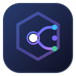

<div align="center">



# RouteNest

### Free-First AI API Routing
**Multiple Providers · Intelligent Routing · Cost-Aware Choices**

RouteNest is a self-hosted AI gateway written in Go. Point your coding agents and AI applications at one endpoint, and RouteNest routes each request to the provider API, local model runtime or connected account that should serve it, falling back in an order you control.

[](https://go.dev)
[](LICENSE)
[](#first-public-preview)
[](#provider-coverage)

**中文:** [中文 README](README.zh-CN.md)

</div>

---

## First public preview

**[RouteNest v0.1.0-beta.1 - First public preview](https://github.com/dhananjaym182/RouteNest/releases/tag/v0.1.0-beta.1)** is a **prerelease for evaluation**, not a stable or production-certified release. APIs, state formats and upstream integrations may change during the beta.

- **Release artifacts:** versioned desktop archives for **Windows x64, macOS Apple Silicon and Linux x64**, three matching SPDX SBOMs and `SHA256SUMS`. Each archive contains one executable, license/notices and release instructions. There is **no Intel macOS artifact**, installer, separate CLI asset or published container image; CLI/server and Docker are source-build options.
- **Runtime and signing:** no Go or Node.js is needed to run the downloads. Windows needs WebView2, macOS uses system WKWebView, and Linux needs GTK 3 plus **WebKitGTK 4.0** on a compatible glibc-based desktop; 4.1 alone is insufficient. Windows is **unsigned**; macOS is **not Developer ID-signed or notarized**. See [desktop requirements](#desktop-app-prebuilt).
- **Verify before extraction:** check the archive and SBOM against `SHA256SUMS`, then verify GitHub build attestations for those files and the manifest, pinned to this repository's Build workflow and release tag. Stop on a mismatch, failure or missing attestation. Provenance and an SBOM are not code-safety certification or OS signing. [Install and verify commands](RELEASE_NOTES.md#install-and-verify).
- **Capabilities and limits:** streaming OpenAI/Anthropic request handling, a **Responses API subset**, account rotation, ordered fallback, model discovery, limits, egress controls and a bilingual admin console. Provider presets are templates, **not integration certification**; free-first/free-only labels are not zero-cost guarantees. Use only authorized accounts and follow upstream terms, pricing and entitlements; Cline account access is unofficial.
- **Setup and data:** no default administrator password; save the first-run recovery code and create a client API key before relying on authenticated inference. A validated empty key list leaves model/inference routes anonymous for compatibility. Provider credentials, refresh tokens and generated client keys are **plaintext**, protected by filesystem permissions rather than encryption at rest. Back up the full data directory before upgrades and keep hosted administration behind HTTPS with narrow trusted-proxy settings.
- **Validation scope:** CI includes automated Go/race, frontend/localization, Docker and browser checks, native builds and windowless readiness self-checks. Simulations and compilation do not certify packaged WebViews, actual OS credential stores, clean-system installation, signed upgrades or every live provider. See [CI validation](#ci-validation) and the tagged workflow results.

[Release notes](RELEASE_NOTES.md) · [Changelog](CHANGELOG.md) · [Security guide](docs/admin-security.md) · [Upgrade and backup guidance](#data-and-upgrades)

## Contents

[First public preview](#first-public-preview) · [Why RouteNest](#why-routenest) · [Highlights](#highlights) · [Light on resources](#light-on-resources) · [Works with](#works-with) · [Supported providers](#supported-providers) · [Quick start](#quick-start) · [Connect a client](#connect-a-client) · [How routing works](#how-routing-works) · [Admin console](#admin-console) · [Security](#security) · [Accounts and upstreams](#accounts-and-upstreams) · [Provider coverage](#provider-coverage) · [Model discovery](#model-discovery) · [Egress proxies](#egress-proxies) · [Data and upgrades](#data-and-upgrades) · [Build from source](#build-from-source) · [CI validation](#ci-validation) · [Project layout](#project-layout) · [Documentation](#documentation) · [Contributing](#contributing) · [License](#license-and-notices)

## Why RouteNest

AI coding tools want one stable endpoint, while the services behind them rate-limit, expire, move and change prices. RouteNest sits between the two and keeps the endpoint steady.

| The problem | What RouteNest does |
| --- | --- |
| A free allowance runs out in the middle of a task | An ordered fallback chain moves to the next entry. Accounts that hit `402` or `429` cool down per model and come back on their own. |
| You have several accounts for one service | Pool them and rotate with `round_robin`, `fill` or `random`. |
| Every tool needs different provider settings | One base URL and one client key. OpenAI and Anthropic clients both work, with streaming. |
| You can't tell which model is really free | Models are classified free or paid from visible signals, such as zero pricing, an upstream free flag or a `-free` ID, and each classification shows its evidence. |
| Provider model lists change without notice | Syncs queue new models for your approval and flag delisted ones, and removing a model also cleans up the combos and routes that referenced it. |
| A long Claude Code session hits the context limit | RouteNest honours the `context_management` edits Claude Code sends and summarises older turns on the server. |
| You are not sure why a request went where it did | **Route check** shows the configuration behind a model, and **Request Logs** record every attempt, with latency, tokens and upstream. |
| You must expose an admin panel | There is no default password. Setup is one-time, access is role-based, and sign-in supports OIDC and SAML. A recovery code is issued at setup. |

## How a request flows

```
 Your client                          RouteNest                              Upstreams
 ───────────                          ─────────                              ─────────
 Claude Code ─┐                ┌─ resolve model or combo ─┐        ┌─▶ provider API / local runtime
 Cline / Roo ─┼─▶ /v1/*  ────▶ ├─ pick account (rotation) ├──────▶ ├─▶ connected account pool
 OpenAI SDK  ─┤  one key       ├─ cool down on 402 / 429  │        └─▶ OpenCode Zen (free models)
 curl        ─┘                └─ fall back to next entry ┘
                                          │
                  stream back in the caller's protocol (OpenAI chunks or Anthropic events)
```

## Highlights

- **One endpoint, several protocols.** OpenAI Chat Completions, a supported subset of the OpenAI Responses API, and Anthropic Messages, all on one port.
- **A large provider catalog.** 111 built-in definitions (109 selectable presets), custom OpenAI-compatible endpoints, and local runtimes such as Ollama, vLLM, LM Studio and llama.cpp.
- **Routing you can read.** Account pools, ordered combos, a global fallback chain, aliases, optional session affinity, and a read-only Route check.
- **Free-first, never a cost promise.** An optional free-only mode filters on RouteNest's classification. See [Model discovery](#model-discovery) for what that does and does not guarantee.
- **Limits you control.** Per-provider daily, per-minute and token limits, with cooldowns visible under **Usage & Quotas**.
- **Per-provider networking.** A default egress proxy pool with failover, a separate pool for Zen, and a per-provider override.
- **A full admin console.** Thirteen pages, English and Chinese, light and dark, with a Quick Start page that builds client examples from your running instance.
- **Administrator access controls.** One-time setup, role-based access, OIDC and SAML, revocable trusted desktop devices, an audit journal, and a recovery code.
- **Runs where you do.** A single Go binary with file-based state and no external database, a desktop app for Windows, macOS and Linux, or Docker.

Provider availability, authentication, free allowances and supported features depend on the upstream service. A preset is a configuration template, not a tested integration. Its presence does not mean every model is available to your account.

## Light on resources

The CLI/server can be built as one statically linked Go binary (`CGO_ENABLED=0`), with an embedded admin console and no Node.js runtime, `node_modules` or external database. State lives in plain files. Desktop downloads also need their platform's WebView libraries.

These measurements are from a Go 1.26.10 development build, not the beta desktop packages; they have not been remeasured for this release.

| Measured on Linux x86-64, empty data directory | Result |
| --- | --- |
| Binary size (admin console included) | 15.5 MB |
| Time until `/ready` answers | about 1 second |
| Memory while it syncs model catalogs at startup | peaks near 155 MB |
| Memory when idle | about 26 MB after a few minutes |
| CPU when idle | about 0% |

Build it the way the Docker image does and read the resident memory from `/proc/<pid>/status` to check these figures on your own machine:

```bash
CGO_ENABLED=0 go build -trimpath -ldflags="-s -w" -o routenest .
```

For context, here is what two similar gateways document that they need, taken from their own repositories in November 2026. We have not measured their memory or CPU use.

| | RouteNest | [9Router](https://github.com/decolua/9router) | [OmniRoute](https://github.com/cheaper-inference/OmniRoute) |
| --- | --- | --- | --- |
| Runtime to install | none | Node.js 22 | Node.js 22 or newer |
| Direct npm dependencies | none | 30 | 105 |
| Building from source | `go build` | README suggests a temporary 2 GB swap file before `npm run build` | `npm` build |

Both of those projects offer features RouteNest does not, such as token compression and a much larger provider catalog. RouteNest's aim is a small footprint with a strong security model.

## Works with

Clients using supported OpenAI or Anthropic request patterns can use RouteNest; full API or provider certification is not implied. The **Quick Start** page generates ready-to-paste setup for these:

<div align="center">
  <table>
    <tr>
      <td align="center" width="104"><br><sub>Claude Code</sub></td>
      <td align="center" width="104"><br><sub>Cline</sub></td>
      <td align="center" width="104"><br><sub>Roo Code</sub></td>
      <td align="center" width="104"><br><sub>OpenCode Zen</sub></td>
    </tr>
  </table>
</div>

## Supported providers

A selection of the presets in the **Connect provider** directory. The full list of 109 is in the admin console, and [Provider coverage](#provider-coverage) explains how to read it.

<div align="center">
  <table>
    <tr>
      <td align="center" width="104"><br><sub>AgentRouter</sub></td>
      <td align="center" width="104"><br><sub>BazaarLink</sub></td>
      <td align="center" width="104"><br><sub>Bluesminds</sub></td>
      <td align="center" width="104"><br><sub>BytePlus</sub></td>
      <td align="center" width="104"><br><sub>Cerebras</sub></td>
      <td align="center" width="104"><br><sub>Cloudflare AI</sub></td>
      <td align="center" width="104"><br><sub>CodeBuddy</sub></td>
      <td align="center" width="104"><br><sub>CodeBuddy CN</sub></td>
    </tr>
    <tr>
      <td align="center" width="104"><br><sub>Dahl</sub></td>
      <td align="center" width="104"><br><sub>DeepSeek</sub></td>
      <td align="center" width="104"><br><sub>Gemini</sub></td>
      <td align="center" width="104"><br><sub>GitHub Copilot</sub></td>
      <td align="center" width="104"><br><sub>Groq</sub></td>
      <td align="center" width="104"><br><sub>Kilo Code</sub></td>
      <td align="center" width="104"><br><sub>Kimi for Coding</sub></td>
      <td align="center" width="104"><br><sub>LLM7</sub></td>
    </tr>
    <tr>
      <td align="center" width="104"><br><sub>MiMo</sub></td>
      <td align="center" width="104"><br><sub>Mistral</sub></td>
      <td align="center" width="104"><br><sub>Morph</sub></td>
      <td align="center" width="104"><br><sub>Nano Banana</sub></td>
      <td align="center" width="104"><br><sub>Nous Research</sub></td>
      <td align="center" width="104"><br><sub>Novita</sub></td>
      <td align="center" width="104"><br><sub>NVIDIA</sub></td>
      <td align="center" width="104"><br><sub>Ollama</sub></td>
    </tr>
    <tr>
      <td align="center" width="104"><br><sub>OpenAI</sub></td>
      <td align="center" width="104"><br><sub>OpenRouter</sub></td>
      <td align="center" width="104"><br><sub>Poolside</sub></td>
      <td align="center" width="104"><br><sub>Qoder</sub></td>
      <td align="center" width="104"><br><sub>Qoder CN</sub></td>
      <td align="center" width="104"><br><sub>Qwen Chat</sub></td>
      <td align="center" width="104"><br><sub>Reka</sub></td>
      <td align="center" width="104"><br><sub>SambaNova</sub></td>
    </tr>
    <tr>
      <td align="center" width="104"><br><sub>Together AI</sub></td>
      <td align="center" width="104"><br><sub>WorkBuddy</sub></td>
    </tr>
  </table>
</div>

<sub>Logos are shown only to identify the services and belong to their respective owners, who do not endorse RouteNest. See [Third-party notices](THIRD_PARTY_NOTICES.md).</sub>

## Quick start

### Desktop app (prebuilt)

Download your archive, matching SPDX SBOM and `SHA256SUMS` from the [v0.1.0-beta.1 release](https://github.com/dhananjaym182/RouteNest/releases/tag/v0.1.0-beta.1), [verify before extraction](#verify-the-download), then open the extracted app. These are archives of standalone executables, not installers. On a confirmed fresh installation a native setup window lets you choose the administrator password, shows a recovery code once, and optionally trusts the device for automatic sign-in. No terminal or environment variable is needed for setup.

| Platform | Release archive | What you need to run it |
| --- | --- | --- |
| Windows x64 | `routenest_0.1.0-beta.1_windows_amd64.zip` | Microsoft Edge WebView2 Runtime. Windows 11 includes it; updated Windows 10 usually has it. If missing, install Microsoft's Evergreen Runtime. |
| macOS Apple Silicon | `routenest_0.1.0-beta.1_darwin_arm64.tar.gz` | macOS with system WKWebView; built on macOS 15. No Intel artifact is published. Running does not need Xcode tools; Intel Macs require a source build. |
| Linux x64 | `routenest_0.1.0-beta.1_linux_amd64.tar.gz` | Compatible glibc-based desktop with GTK 3 and WebKitGTK 4.0 runtime libraries; built on Ubuntu 22.04. On Ubuntu 22.04 the packages are `libgtk-3-0` and `libwebkit2gtk-4.0-37`. WebKitGTK 4.1 alone is insufficient. |

Each archive extracts to `routenest_0.1.0-beta.1_<platform>/`, containing `routenest-desktop.exe` on Windows or `routenest-desktop` on macOS/Linux, plus `LICENSE`, `THIRD_PARTY_NOTICES.md` and release instructions as `README.md`. Matching SBOMs are `routenest_0.1.0-beta.1_windows_amd64.spdx.json`, `routenest_0.1.0-beta.1_darwin_arm64.spdx.json` and `routenest_0.1.0-beta.1_linux_amd64.spdx.json`. They inventory the built artifacts, not certify them as vulnerability-free.

Go, Node.js and development headers are not required to run these artifacts. Linux automatic desktop sign-in optionally needs an unlocked Secret Service; without it, use password sign-in. Older OS versions and clean-system installation are not broadly certified.

**Unsigned / unnotarized:** Windows has no trusted code signature; macOS has no Developer ID signature or notarization. After verification, SmartScreen may require **More info → Run anyway**, and Gatekeeper may require **Open** or approval under **System Settings → Privacy & Security**. Approve only the verified file; do not disable system-wide protections.

### Verify the download

Use the archive, its SBOM and `SHA256SUMS` from the same release. The manifest covers the three archives and three SBOMs; verify it and the downloaded files before extracting. For Linux x64, after downloading the three files:

```bash
(
set -euo pipefail
base=routenest_0.1.0-beta.1_linux_amd64
for file in "$base.tar.gz" "$base.spdx.json"; do
    awk -v file="$file" '$2 == file { print; n++ } END { if (n != 1) exit 1 }' SHA256SUMS | sha256sum --check -
done
for file in "$base.tar.gz" "$base.spdx.json" SHA256SUMS; do
    gh attestation verify "$file" --repo dhananjaym182/RouteNest --signer-workflow dhananjaym182/RouteNest/.github/workflows/build.yml --source-ref refs/tags/v0.1.0-beta.1
done
)
```

Both archive and SBOM checksums must report `OK`, and all attestations must verify this repository's Build workflow and release tag. Stop on any mismatch, failure or missing attestation. macOS uses `shasum`; Windows uses `Get-FileHash`. Full download, platform-specific verification, extraction and launch commands are in [Release notes](RELEASE_NOTES.md#install-and-verify). Checksums check packaged bytes, not an extracted executable against its archive digest; attestations check provenance, not code safety, OS signing or provider certification. If the published release is immutable, the release notes also show `gh release verify` and `gh release verify-asset` for GitHub's signed release/asset binding.

### Run the binary

Building requires Go 1.26.11 or newer.

```bash
go build -o routenest .
./routenest                # 127.0.0.1:3457
./routenest -port 8080     # custom port
./routenest -host 0.0.0.0  # requires the hosted-admin settings in docs/admin-security.md
```

This builds the CLI/server, not the desktop app. Open <http://127.0.0.1:3457/admin/> for the admin console (`/admin` redirects to `/admin/`). The listen address can also be set with `CLINE_PROXY_HOST`. Run `./routenest --help` or `./routenest auth help` for password, recovery and trusted-device guidance.

### Docker

```bash
docker compose up -d
docker compose logs -f
docker compose down
```

The container listens on `0.0.0.0:3457` and the sample compose file publishes it only on host loopback, for a local TLS reverse proxy. Set the required administrator variables in `.env` first (see [the Docker example](docs/admin-security.md#docker-and-reverse-proxy)). State lives in `/app/data`, mounted to `./data`, so recreating the container keeps your data while the volume is retained. Do not expose the backend port directly to the internet.

### First run

**There is no default or temporary password.** How you set the first one depends on how you started RouteNest:

| How you start | What happens |
| --- | --- |
| **Desktop app** | A native setup window asks for your new password and shows the recovery code. No one-time key is involved. |
| **Binary run from a terminal** (Windows, macOS, Linux) | For a confirmed new data directory, start once with `-initialize-empty-account-store`. RouteNest prints a one-time secret in the terminal or console window that started it. Open `/admin/`, enter the secret, choose a permanent password, then save the recovery code shown. Restarting before you finish prints a new secret. |
| **Docker, a service, or any start without a terminal** | Nothing can print a secret, so set `ROUTENEST_ADMIN_BOOTSTRAP_PASSWORD` (12 to 1024 bytes, generated randomly and delivered privately) before the first start, and `ROUTENEST_INITIALIZE_EMPTY_ACCOUNT_STORE=true` for that first start only. Open `/admin/`, enter the secret, and choose a permanent password. Remove both variables afterwards. |

The sign-in page tells first-run users where to find the key. Neither `-initialize-empty-account-store` nor the bootstrap secret can reset an existing installation.

After sign-in, use the **Quick Start** page. It builds ready-to-copy examples from your running instance, with your real base URL and a model that is actually enabled. It never inserts a real API key. Then:

1. Connect a Cline account, native OpenCode Zen, or a provider API key.
2. Check that a model is enabled, and generate a client API key if you want authenticated client access. Until at least one key exists, key-wrapped model routes accept anonymous requests under the documented compatibility policy.
3. Send your first request.

The built-in update check follows stable releases only and may not advertise this beta; download previews explicitly from the tagged release page.

**Forgot your password?** Select **Forgot password?** on the sign-in page. With a saved recovery code you can reset the main `admin` password, and a replacement code is shown once. If no recovery code was ever created, the same link explains the options: other users ask a security administrator, and the main administrator runs `routenest auth recover` on the server. See [Security](#security).

## Connect a client

Every protocol runs on the same port (default `3457`). Once at least one client API key exists, keys are accepted as `Authorization: Bearer <key>` or `x-api-key: <key>`. Use a model ID returned by `/v1/models`, or the name of an enabled combo.

```bash
export ROUTENEST_KEY="<key generated in the console>"
curl http://127.0.0.1:3457/v1/models -H "Authorization: Bearer $ROUTENEST_KEY"
```

**OpenAI-compatible**

```bash
curl http://127.0.0.1:3457/v1/chat/completions \
  -H "Authorization: Bearer $ROUTENEST_KEY" \
  -H "Content-Type: application/json" \
  -d '{"model":"<model-or-combo>","messages":[{"role":"user","content":"hi"}]}'
```

```python
from openai import OpenAI

client = OpenAI(
    base_url="http://127.0.0.1:3457/v1",
    api_key="<key generated in the console>",
)
```

**Anthropic-compatible, including Claude Code**

```bash
curl http://127.0.0.1:3457/v1/messages \
  -H "x-api-key: $ROUTENEST_KEY" \
  -H "anthropic-version: 2023-06-01" \
  -H "Content-Type: application/json" \
  -d '{"model":"<model-or-combo>","max_tokens":64,"messages":[{"role":"user","content":"hi"}]}'

export ANTHROPIC_BASE_URL=http://127.0.0.1:3457
export ANTHROPIC_AUTH_TOKEN="$ROUTENEST_KEY"
```

When several providers offer a model with the same name, pin the source with `model@ProviderName`. A pinned request fails with an error instead of quietly switching source.

### API compatibility

Compatibility is implementation-level. It does not guarantee every field, provider extension or model feature.

| Endpoint | Format | Notes |
| --- | --- | --- |
| `POST /v1/chat/completions` | OpenAI Chat Completions | Streaming and non-streaming; tools, reasoning fields and usage where the upstream supplies them |
| `POST /v1/responses` | OpenAI Responses subset | Converted to an upstream chat-completions call; text, tools, reasoning content, streaming events and usage |
| `POST /v1/messages` | Anthropic Messages | Streaming and non-streaming; tool use and results, thinking content and usage |
| `POST /v1/messages/count_tokens` | Anthropic token count | A local estimate, not an upstream tokenizer |
| `GET /v1/models` | OpenAI model list | Enabled models and enabled combos |
| `GET /v1/health`, `GET /health` | Liveness probe | Public; version and active account count |
| `GET /v1/ready`, `GET /ready` | Readiness probe | Public; HTTP 200 only when client-authentication storage is available, otherwise 503 |

Verified behavior includes SSE streaming of text, tool calls and reasoning content, tool conversion between OpenAI and Anthropic shapes, usage metadata when the upstream returns it, Responses API event sequences, and failure recording when a stream is cut short or the client disconnects.

Known limitations:

- Protocol translation covers text, tool calls and thinking content. Non-text content such as images is not translated between protocols.
- `response_format` and similar fields are forwarded to OpenAI-compatible upstreams, but structured-output behavior is not normalized across providers.
- The Responses API is implemented by converting to chat completions, so anything that cannot be expressed that way is unsupported.
- `count_tokens` is a conservative local estimate, not the provider's exact count.
- Upstream models, authentication methods and provider-specific features can change without notice.

## How routing works

1. A client sends a request with a model name or combo name to a `/v1/*` endpoint.
2. RouteNest resolves the model to a Cline account pool, an OpenCode Zen upstream, or a provider preset or custom provider.
3. The pool selects an account using `round_robin`, `fill` or `random`. Accounts that hit `402` or `429` cool down per model and recover automatically.
4. On an eligible upstream failure, RouteNest tries another account or provider. For a combo, it moves to the next entry in the configured order.
5. Responses are relayed as SSE in the inbound protocol, so OpenAI clients receive OpenAI chunks and Anthropic clients receive Anthropic events.

**Combos.** A combo is a named, ordered list of models. Its order is authoritative: unhealthy entries are skipped, not reordered. The combo editor tracks unsaved changes, validates before saving, previews what changed, and lets you filter the model picker by price and source. Emergency fallback to the global free chain is opt-in and labelled in the console.

**Routing policy.** The global fallback chain, account rotation strategy, default model, model aliases and optional session affinity live under **Routing → Routing Policy**.

**Route check.** **Routing → Route check** shows the configuration behind a model: its candidates, fallback configuration and the most recent stored request. It reads existing configuration and stored records only. It does not predict or guarantee where a future request will go.

## Admin console

The console at `/admin/` requires administrator sign-in. It has thirteen pages in five groups:

| Group | Page | What it is for |
| --- | --- | --- |
| Workspace | **Overview** | Request volume, health and a setup guide |
| Workspace | **Quick Start** | Client examples built from your running instance, with progress for provider, key and client setup |
| Connections | **Providers** | Provider inventory, presets, custom providers, keys, base URLs, limits and OAuth connections |
| Connections | **Accounts & Credentials** | Account pool, logins, rotation, import and export, and client API keys |
| Connections | **Global Egress Proxy** | The default proxy pool and how an exit is chosen |
| Model management | **Models & Offerings** | Model catalog, per-provider offerings, custom models, default model and model tests |
| Model management | **Routing Policy** | Fallback chain, rotation, aliases and session affinity; Route check; Runtime Tuning |
| Model management | **Routing Combos** | Named ordered fallback lists |
| Observability | **Request Logs** | Latency, tokens, TPS, upstream, model and attempts |
| Observability | **Usage & Quotas** | Usage, limits and cooldowns |
| Observability | **Provider Health** | Provider and credential status |
| System | **Administrator Security** | Identity and password, users and roles, SSO providers, trusted desktop devices, listen security and recovery |
| System | **Settings & Runtime** | Version, runtime details and update check |

The interface is English and Chinese (it follows the browser language and can be switched in the sidebar) and has light and dark themes. On desktop widths the sidebar collapses to a rail, and `Ctrl+B` (`Cmd+B` on macOS) toggles it. Browser tabs are titled with the current page, such as `Quick Start | RouteNest`.

Roles limit what each administrator sees: a viewer can read, while changing providers, credentials or security settings needs the matching role. Pages a role cannot use explain why instead of failing silently.

## Security

> RouteNest has no universal default password and never permits anonymous administrative operations. A fresh install starts in one-time setup mode and requires a permanent local administrator password before normal administration. The static admin shell and a few narrow status, setup, sign-in and SSO entry routes are public, but they grant no administrative access.

- **First-run setup:** the desktop app sets up natively with no terminal. From a terminal, the one-time secret is printed to the controlling terminal or console window. With no terminal (Docker, services), it must be supplied as `ROUTENEST_ADMIN_BOOTSTRAP_PASSWORD`. Once an administrator exists, that variable is ignored.
- **Recovery code:** setup, in the desktop app or the browser, issues a single-use recovery code and shows it once, behind a confirmation that you saved it. If persistence needs a restart, the exact code is still returned once with a restart-required notice. **Forgot password?** consumes the code, issues a replacement, revokes administrator sessions and trusted devices, and keeps provider, model and routing data. Installs created before browser setup issued codes can generate one under **Administrator Security → Recovery code**. Without a code, the link explains how to recover; it does not expose the instructions up front.
- **Passwords:** permanent passwords need at least 8 characters and at most 1024 UTF-8 bytes. A password change revokes all sessions and trusted devices for that administrator.
- **Sign-in options:** local accounts, plus OIDC and SAML. Administrator roles are `viewer`, `provider_admin`, `credential_admin`, `security_admin` and the local `break_glass` account.
- **Desktop trust:** after password sign-in you can explicitly trust the desktop app. RouteNest stores a random, revocable credential in Windows Credential Manager, the macOS Keychain or Linux Secret Service, never the password. Ordinary browsers always sign in independently. If protected storage is unavailable or damaged, sign-in falls back to the password with no plaintext storage.
- **Lock and sign out:** Lock ends only the current session. Sign out ends it and pauses desktop automatic sign-in without asking for the password. Forget this device revokes its registration and verifies the local credential is deleted. Password sign-in never silently resumes paused trust.
- **Native isolation:** Wails v2.17.1 keeps setup and the dashboard on the embedded origin with no extra binding origins. Desktop session handoffs and protected API calls stay in process, so an ordinary browser or a process holding a localhost port cannot receive native authority.
- **Two kinds of keys, two controls:** client API keys protect the model and inference routes (`/v1/*`) once at least one key is loaded. Administrator sessions and server-side roles protect administration. Sessions store only hashed tokens, survive a restart, can be revoked, and need a session-bound CSRF token for every change. `/health` and `/v1/health` are public liveness probes. `/ready` and `/v1/ready` are public readiness probes that return 503 when client-authentication storage is unavailable. An empty key list leaves the key-wrapped routes open for compatibility, but only after valid storage has loaded.
- **Client-key safety:** corrupt, unreadable, partially restored or uncertain account-pool state fails closed on key-wrapped routes. A confirmed fresh installation sets `ROUTENEST_INITIALIZE_EMPTY_ACCOUNT_STORE=true` for one startup. Keys use 256 bits of cryptographic randomness, and changes are published only after durable persistence. Deleting a key needs `credential.write` and `dangerous.execute`. Deleting the final key also needs explicit confirmation that client authentication will be disabled.
- **Account-only deletion:** **Delete All Accounts** removes Cline accounts and their account-owned state only. Client keys, models, the default model, listener settings and migration markers are preserved, and success is reported only after durable persistence.
- **Hosted administration:** the binary and desktop app bind to `127.0.0.1` by default. A non-loopback listener is rejected unless an exact public URL, trusted-proxy mode and trusted proxy CIDRs are configured. An HTTP canonical origin is accepted when HSTS is off, so terminating HTTPS at the trusted proxy remains a deployment requirement.
- **Docker:** the sample compose file binds the backend port to host loopback and requires explicit setup, public-URL and proxy settings. Do not expose the backend port directly to the internet.
- **Sensitive data:** account refresh tokens, provider credentials and generated client keys are stored in plaintext in the data directory, protected by filesystem permissions rather than encryption at rest. OS-protected desktop trust does not encrypt provider secrets. Protect the directory and backups, and never commit or share them; OS credential stores do not defeat same-user malware or host compromise.

See [Administrator security and SSO](docs/admin-security.md) for roles, OIDC, SAML, recovery and reverse-proxy configuration. `routenest auth help` and `routenest auth status` give non-mutating help and a read-only status. `routenest auth recover` is the owner-controlled offline recovery command for a lost recovery code.

## Accounts and upstreams

### Cline accounts (unofficial)

RouteNest can add a Cline account through Cline's device-authorization flow, by importing a refresh token, or by batch import, and can rotate a pool of accounts. This integration is **unofficial and not supported or endorsed by Cline**. It uses Cline account credentials and Cline's API from outside the Cline client.

Cline's documentation states that free-model usage is not supported through the Cline API and is limited to the Cline IDE extension and CLI. RouteNest reads Cline's recommended-models endpoint, which groups free, Cline Pass and recommended models, but free or Cline Pass access through RouteNest is not an officially supported path and may stop working or be restricted at any time. Review [Cline's free-model documentation](https://docs.cline.bot/getting-started/free-models) and [Terms of Service](https://cline.bot/tos) before using this integration.

### OpenCode Zen

A dedicated integration for OpenCode Zen free models. Paid Zen models are rejected rather than forwarded. Zen has its own egress proxy pool and cooldown handling.

### Qoder

Device-login connections are supported alongside Cline accounts.

### Provider APIs and local runtimes

Add any OpenAI-compatible endpoint as a custom provider with its own base URL, key, model IDs, limits and egress proxy. Local runtimes (Ollama, vLLM, LM Studio, llama.cpp and similar) work without a key, and loopback and private-network targets bypass egress proxies.

## Provider coverage

The built-in registry holds **111 provider definitions**. Two of them are fixed runtime providers (Cline and OpenCode Zen), so the **Connect provider** directory exposes **109 selectable presets**. Of those, **34** carry a `freeTier` provider-level hint and **9** use a browser or device login.

`freeTier` and `kind` are display and grouping hints, not per-model access entitlements. Presets include seed model IDs and, where defined, a catalog fetcher. A registry entry does not establish that the service is currently reachable, that an account is entitled to a model, or that provider-specific features work.

Authentication depends on the provider:

- API keys for most hosted providers.
- Browser or device login for some presets, for example GitHub Copilot, Kilo Code, Kimi for Coding, Qwen Chat, CodeBuddy and WorkBuddy.
- No authentication for local runtimes.
- Cline account credentials and native OpenCode Zen configuration for those two integrations.

Only a subset of presets and request patterns is exercised by the repository's tests and real deployments. Treat the catalog as a starting point and verify each provider with a small request before relying on it. Provider-registry and logo attributions are listed in [THIRD_PARTY_NOTICES.md](THIRD_PARTY_NOTICES.md).

## Model discovery

- RouteNest fetches Cline's recommended-model list at startup, re-syncs it hourly, and can sync on demand from the console. **Sync all** also checks every connected provider.
- A provider sync does not change your catalog silently. New models wait in a batch for your approval, and models the upstream no longer lists are flagged as delisted.
- Presets with a catalog fetcher can refresh their own model or pricing lists.
- Custom model IDs can be added for endpoints that are not in any catalog.
- Each free or paid classification shows the signal behind it, such as zero pricing, an upstream free flag, a `free` ID suffix or segment, a provider-wide free allowance, or "no free signal, so paid".
- When no default is configured, RouteNest first prefers an active, enabled, non-delisted Cline model classified as free. After catalog initialization, if none exists, it can select the first active, enabled, non-delisted catalog model of any cost.
- An optional free-only mode rejects models that are not classified as free. **This is not a zero-cost guarantee:**
  - Filtering relies on RouteNest's current model classification, which may be incomplete, stale or inaccurate.
  - A model or provider being labelled free does not guarantee that the underlying account, route or request is free of charge.
  - Before relying on this setting, verify your provider's terms of service, account entitlements, pricing and usage limits. Do not treat free-only mode as a guarantee of zero cost.
- **You can override the detection for a whole provider.** Free-or-paid detection is a guess from names, prices and flags, and many providers make a model free without marking it. Each provider therefore has a **Free-only handling** setting in its editor:

  | Setting | What Free-only mode does with that provider's models |
  | --- | --- |
  | **Auto-detect per model** (default) | Each model's own classification decides. Models judged paid or unknown are skipped. |
  | **All models are free** | You declare the provider free. Every model is allowed. |
  | **Mixed free and paid: allow every model** | Free-only mode does not filter this provider. Paid models stay labelled paid but are allowed, so they can cost money. |

  Only you change this setting. Presets, model syncs and imports never do, and the separate **Free source (for statistics)** field does not affect it. It applies as soon as you save, with no re-sync. A model whose tier you set by hand in the model editor always keeps that tier, even on a provider set to allow everything. When a model is refused, the combo trace and Route check name the access class and which of the two settings would allow it.

## Egress proxies

For upstreams that are region-restricted or rate-limited:

- **Default egress pool** (admin console: **Global Egress Proxy**). Used by every provider that has no proxy of its own, and by Cline sign-in, token refresh and model sync. Round-robin and random choose per new connection. If a proxy fails to connect, the next one in the list is used and the failed one goes last for 30 seconds.
- **Per-provider override.** A provider's own egress proxy, or `-` for a direct connection, replaces the default pool for that provider.
- **OpenCode Zen egress pool.** A separate pool with cooldown for rate-limited exits.

Priority is provider override, then default egress pool, then environment proxy (`HTTPS_PROXY`), then direct. `localhost` and private-network IP addresses always connect directly. A local service reached by hostname (for example `ollama.lan`) is still sent through the pool, so set that provider's override to `-`.

## Data and upgrades

By default, RouteNest stores state in the operating system's per-user config directory:

- Linux: `$XDG_CONFIG_HOME/routenest`, normally `~/.config/routenest`
- macOS: `~/Library/Application Support/routenest`
- Windows: `%AppData%\routenest`

Set `ROUTENEST_DATA_DIR` to use an explicit directory, such as a mounted Docker volume. The legacy `CLINE2API_DATA_DIR` variable remains a lower-priority compatibility override.

| File | Purpose |
| --- | --- |
| `.routenest-accounts.json` | Cline account pool, client API keys, logical-model settings, saved listener host, and legacy administrator migration markers |
| `.routenest-accounts.json.initialized` | Initialization witness for the account and client-authentication store; back it up and restore it with the account-pool file |
| `admin-auth/.routenest-admin-auth.json` | Administrator users, role and provider metadata, trusted-device verifiers and hashed sessions |
| `admin-auth/.routenest-admin-auth.journal` | Fsynced, hash-chained administrator security and audit journal |
| `admin-auth/sso-secrets/` | Approved root for owner-only OIDC and SAML secret files |
| `.routenest-config.json` | Proxy configuration, aliases, policies and model combos |
| `.routenest-connections.json` | Provider connection records and their access and refresh tokens (Qoder and other non-Cline logins) |
| `.routenest-credentials.json` | Legacy single Cline refresh-token helper kept for file-format compatibility; current login and routing do not read or write it |
| `.routenest-providers.json` | Custom providers |
| `.routenest-providers-cooldowns.json` | Provider cooldown state |
| `.routenest-providers-sync.json` | Provider catalog sync state |
| `.routenest-proxy.json` | Default (global) egress proxy pool |
| `.routenest-zen.json` | OpenCode Zen configuration and egress pool |
| `.routenest-onboarding.json` | Setup-guide progress: which providers you verified and when the first gateway request succeeded |
| `.routenest-request-logs.json` | Request logs |
| `capture-logs/` | Interactive OAuth capture output; may contain authorization traffic |
| `override.md` | Optional system-prompt override, read from the working directory |

On first use, RouteNest copies missing current `.routenest-*` files and legacy `.cline-*` files from the executable directory, working directory, `~/.routenest/` and `~/.cline2api/` into the selected data directory. Existing destination files always win, migration is idempotent, and source files are preserved as recovery backups.

If the pool and witness are both absent, RouteNest will not infer that an existing or partially restored data directory is a fresh installation. Restore a valid pool file and restart. A valid restored pool without its witness is accepted, and the witness is recreated only after the pool has been validated.

On Unix-like systems the data and capture directories are restricted to `0700` and known state files to `0600`. Windows private paths use protected ACLs granting the current user and SYSTEM access, and accept the owner Windows assigns to files this process creates (the Administrators group for an elevated process). RouteNest fails startup with an actionable error if it cannot establish safe permissions, and never falls back to writing secrets beside the executable.

Durable security-sensitive writes sync the temporary file before replacement and attempt to flush the containing directory afterwards. Windows replacement uses Go's directory-rooted rename, not a write-through `MoveFileEx` guarantee; a post-replacement flush failure is reported as uncertain, not ordinary success. These mechanisms do not guarantee protection against faulty storage hardware or all filesystem/power-loss scenarios.

### Before upgrading or rolling back

1. Stop every RouteNest process and securely back up the **entire selected data directory**. Keep `.routenest-accounts.json` and its `.initialized` witness together, and `admin-auth/.routenest-admin-auth.json` and its journal together. Include referenced SSO secrets and separately protect environment-based secrets, the saved recovery code and any working-directory `override.md`.
2. Download and verify the new archive, SBOM and manifest using `SHA256SUMS` and their GitHub attestations, extract into a separate directory, then replace only the executable. Reuse the same data directory and OS user; do not add first-run initialization flags or bootstrap variables to reset an established install.
3. Restart, sign in, check readiness and send a small request through each provider you rely on. If storage is missing, corrupt or partially restored, stop and restore a valid backup rather than deleting identity files or bypassing initialization guards.
4. Beta state formats may change, and older binaries can reject newer administrator metadata. Roll back with the old executable **and a complete compatible backup**, never a mixed snapshot/journal or hand-edited identity state. Desktop-trust credentials live in the OS vault, not the directory backup; moving user, machine or directory may require password sign-in and explicit re-enrollment. Treat restored sessions/keys as sensitive and revoke or rotate them if a backup may have leaked.

> The data files contain plaintext refresh tokens, provider credentials and generated client API keys. Encrypt or otherwise securely protect backups, and never publish them or commit them to Git.

## Build from source

The CLI binary requires Go 1.26.11 or newer. Building the desktop app also requires the target OS toolchain and native WebView dependencies; see [desktop build instructions](desktop/README.md#building-for-each-platform).

### Binary

```bash
go build -o routenest .
```

### Desktop app

Wails uses native WebView bindings. Build on the target OS rather than treating a cross-build as runtime validation. With the toolchain installed:

```bash
./desktop/build.sh
```

Windows needs Go and a C toolchain. macOS needs Xcode Command Line Tools; native macOS builds also link `UniformTypeIdentifiers`, as shown in the desktop guide. The default Linux script and release build target GTK 3 and WebKitGTK **4.0**, for example `libgtk-3-dev` and `libwebkit2gtk-4.0-dev` on Ubuntu 22.04. A source build against 4.1 requires the extra `webkit2_41` tag, not just installing 4.1 packages; see [the Linux build options](desktop/README.md#linux).

Development packages are only needed to compile. Release users need the matching runtime libraries, not headers. The official macOS artifact is Apple Silicon only.

## CI validation

The [Test workflow](.github/workflows/test.yml) is configured to run:

- Module verification, Go unit/integration tests, desktop-tag authentication tests, vet and race checks on **Linux and Windows**, including dedicated Windows persistence runtime tests.
- JavaScript syntax/unit contracts and localization checks on Linux.
- Authenticated Chromium navigation, provider-setup and security journeys, plus a separate desktop setup/login **bridge simulation** on Linux.
- A source-built Docker persistence smoke test on Linux.

The [Build workflow](.github/workflows/build.yml) depends on the test workflow, validates release-tag metadata, compiles production-tag desktop tests without executing them, builds natively on Windows x64, macOS 15 arm64 and Ubuntu 22.04 x64, and runs each executable's **windowless `/ready` self-check**. It then packages versioned archives with license/notices and instructions, generates SPDX SBOMs, validates the exact asset inventory and `SHA256SUMS`, and generates tag-bound build/SBOM attestations before creating a reviewable prerelease draft. A self-check starts the embedded gateway; it does not open a window or exercise an OS credential store. A draft is not publication or proof of release immutability.

Read the tagged workflow run for actual pass/fail results. Automated tests, browser runs, simulations, checksums and provenance are **not** full packaged-WebView, real-vault, clean-install/reopen, signed-upgrade, OS-version or live-provider certification. Publication of these docs is not a runtime pass report.

## Project layout

```
main.go, desktop_main.go   thin CLI and desktop entry points
internal/app/              service composition shared by both entry points
internal/proxycore/        HTTP routes, protocol bridging, Responses and SSE
internal/protocol/         OpenAI and Anthropic wire formats
internal/routing/          candidate planning, model discovery and policy
internal/dispatch/         attempt execution, fallback and tracing
internal/providers/, providerreg/, zen/   provider registry, presets and OpenCode Zen
internal/egress/           shared HTTP transport, proxy and retry policy
internal/combos/           named model combinations
internal/compaction/       context management and compaction
internal/budget/           provider limits and token accounting
internal/adminauth/, adminsso/, desktopauth/   administrator identity, OIDC/SAML, desktop trust
internal/admin/            admin API plus the embedded UI in internal/admin/ui/
internal/accounts/, connections/, credentials/, requestlog/, store/   persistent state
desktop/                   Wails shell and build scripts
scripts/                   operational scripts (Docker smoke test, updater)
docs/                      design notes, security guide and assets
```

The Go module path is `routenest`. The repository root keeps the CLI and desktop entry points plus the local administrator recovery command. Application composition and all service code live under `internal/`.

## Documentation

| Document | What it covers |
| --- | --- |
| [docs/admin-security.md](docs/admin-security.md) | Roles, OIDC and SAML, trusted devices, recovery, Docker and reverse-proxy settings |
| [RELEASE_NOTES.md](RELEASE_NOTES.md) | Preview caveats, download, verification and installation commands |
| [CHANGELOG.md](CHANGELOG.md) | User-facing changes by release |
| [DESIGN.md](DESIGN.md) | Admin console design rules |
| [CONTRACTS.md](CONTRACTS.md) | Contract reconciliation, implementation evidence and explicitly proposed/unresolved decisions |
| [CONTEXT.md](CONTEXT.md) | Domain glossary |
| [desktop/README.md](desktop/README.md) | Building and packaging the desktop app |
| [CONTRIBUTING.md](CONTRIBUTING.md) | How to work on the project |

## Contributing

Run the same checks as CI before you open a pull request:

```bash
go vet ./...
go test -count=1 ./...
node --test tools/*.test.mjs
node tools/i18n_check.js   # translations: no gaps, duplicates, unused keys or unkeyed Chinese text
```

CI is configured for these checks and the additional [validation scope](#ci-validation) above. See [CONTRIBUTING.md](CONTRIBUTING.md) for contributor expectations; historical reports are not current workflow results.

## License and notices

RouteNest is distributed under the [MIT License](LICENSE). It began as a fork of [Cline2API](https://github.com/luawei1/cline2api), and the upstream copyright notice is retained in [LICENSE](LICENSE). Third-party material, including part of the provider catalog and the provider logos shown above, and the licenses it ships under are listed in [THIRD_PARTY_NOTICES.md](THIRD_PARTY_NOTICES.md).

RouteNest is not affiliated with or endorsed by Cline, OpenCode, Qoder, or any provider listed in the catalog. Use it only with accounts and credentials you are authorized to use, and comply with each provider's terms of service. Provider names, logos and trademarks belong to their owners.
