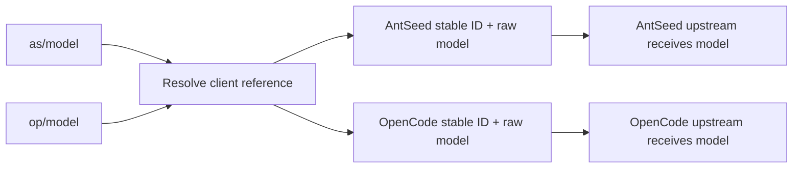

# Provider model isolation

The AntSeed combo picker saved a model ID without its provider pin. ID-only
selection and metadata lookup also merged AntSeed with OpenCode when both
offered the same model. The saved `antseed-coding` configuration confirmed the
missing pins; four controller regressions reproduced the selection and label
failures before changes.

## Correction and file layout

| File or directory | Correction |
| --- | --- |
| `internal/admin/ui/js/12_combo_catalog.js` | Identify an offering by model ID, source and provider instance; resolve labels from the selected offering. |
| `internal/admin/ui/js/12_combos.js` | Preserve provider identity through selection, save, reorder and test; count only the current active entries in test summaries. |
| `internal/admin/ui/js/13_model_cleanup.js` | Reconcile provider-scoped selections when an offering is removed. |
| `internal/combos/combos_projections.go` | Return individual provider offerings with real names, stable IDs and qualified model names. |
| `internal/combos/combos_store.go`, `combos_execution.go` | Normalize qualified entries to raw IDs plus stable pins; preserve the serving provider through execution. |
| `internal/models/offerings.go` | Require model declarations; inherit legacy capabilities only from an unambiguous matching provider. |
| `internal/providers/selection.go` | Resolve stable provider IDs before display names; unavailable IDs never fall through to another instance. |
| `internal/routing/model_reference.go`, `model_offerings.go` | Share qualified-name resolution and scoped discovery; keep the raw ID separate from the provider pin. |
| `internal/routing/snapshot.go`, `candidates.go`, `dispatch.go` | Respect pins in every execution mode and configured chain; never use global fallback for a direct provider pin. |
| `internal/config/provider_model_prefixes.go` | Persist compact prefix-to-provider-ID bindings in the existing proxy configuration. |
| `internal/config/model_removal.go` | Prune a removed provider's qualified references while keeping live siblings and literal `@` IDs. |
| `internal/providers/model_prefixes.go` | Reserve prefixes during startup/provider save; avoid mutations in GET projections. |
| `internal/adminapi/config.go` | Expose the prefix map and reject aliases that shadow a reserved namespace. |
| `internal/admin/model_test_api.go` | Resolve qualified probes and single-entry filters; use stable provider IDs without falling through to sibling names. |
| `internal/admin/provider_system_api.go` | Expose the registered qualified name and real provider name on each offering without changing its raw IDs. |
| `internal/admin/ui/js/13_models.js`, `18_global.js` | Show qualified names in the model catalog and offerings, support alias search and copy the exact client name. |
| `internal/admin/model_test_namespace_test.go` | Cover probe ID collisions, unavailable pins, raw upstream IDs, disabled OpenCode and provider-specific filters. |
| `tools/admin_combo_isolation.test.mjs` | Exercise real generated selection handlers, save payloads and provider badges. |
| `tools/admin_combo_isolation_verify.mjs` | Verify the assembled picker, real API saves, reloads and test results in an isolated browser/server. |

## Naming contract

`op/deepseek-4-1` identifies OpenCode; `as/deepseek-4-1` identifies AntSeed.
The internal reference retains the original model ID and a stable provider ID.
The original upstream ID, including any `@` characters, is sent unchanged.
Bare names retain automatic routing for compatibility.

To inspect a registered name in the administrator console, open **Models →
Model Catalog**, expand a model group or search for `as/`, and inspect the
**Provider model names** below a model's raw ID. Click a name to copy it. In
**Models → Provider Model Offerings**, the **Client model name** column shows
the qualified name; the **Upstream model** column keeps the original ID.

The optional `providerModelPrefixes` map belongs to `.routenest-config.json`.
Bindings remain reserved after provider rename or removal. Additional instances
receive a deterministic suffix; a prefix is never reassigned to a different
provider. Qualified requests fail when their selected provider is unavailable.
They do not enter another provider's fallback chain.



Model discovery keeps the bare automatic name and adds one qualified name per
provider offering. A combo selection saves the raw `model`, `source` and stable
`provider` ID. Names, access classes, disabled status, thinking levels and context
limits come from that offering. A mandatory administrator alias provider must
resolve to a registered namespace; missing or ambiguous names are rejected.

## Delivery and verification

1. Lock the reported failures with controller and provider-pin regressions.
2. Repair the UI identity and stable-ID selection boundaries.
3. Add compact aliases, shared normalization, scoped catalog projections and
   raw-ID handling; preserve existing bare references and unique-name pins.
4. Verify AntSeed/OpenCode collisions, provider failures, raw `@` IDs,
   prefix collisions/rename/restart/removal, all three protocols and routing
   modes, and model-removal compatibility.
5. Run the Go suite, vet, translation/syntax/UI gates and isolated browser
   flows; review the task changes while preserving concurrent edits.

Existing unpinned combos cannot recover their intended provider from the model
ID alone. Repair only the specific AntSeed combo identified by the operator;
preserve every unrelated combo and setting.

The identified `AntSeed Coding` combo has been repaired: all seven entries now
store the AntSeed instance ID. The live configuration and previous executable
were backed up privately before the atomic repair. Restart persisted `as`, `op`
and `cl` bindings and returned HTTP 200 from the administrator page; unrelated
settings and combos were verified unchanged.

Verification passed the full Go suite, a fresh final administrator package run,
targeted routing and probe race checks, `go vet`, all 85 JavaScript tests, and
translation/syntax checks. The final isolated browser run passed 40 cases and
914 checks across light/dark themes and 390/1440px viewports, including actual
save/test APIs, stable disk pins, raw `@` IDs, cleanup, reload and summaries.
Catalog/offerings display and alias search were verified against real API
projections; 48 browser clipboard readbacks preserved the exact qualified name.

Run the focused regressions and browser check:

```sh
node --test tools/admin_combo_isolation.test.mjs tools/admin_model_sync.test.mjs
go test ./internal/routing ./internal/integration -run 'ProviderModelNamespace|AliasProvider' -count=1
go test ./internal/admin -run 'TestAdminNamespace' -count=1
go build -o /tmp/routenest-provider-model-isolation-verification .
node tools/admin_combo_isolation_verify.mjs
```
